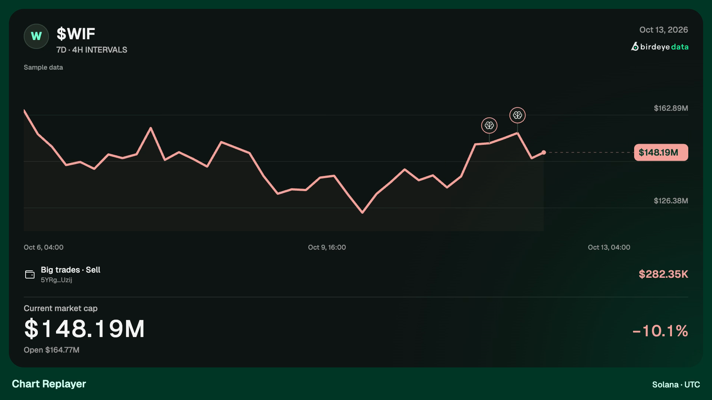
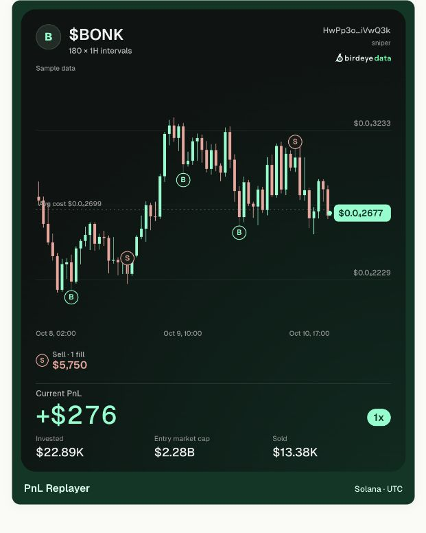
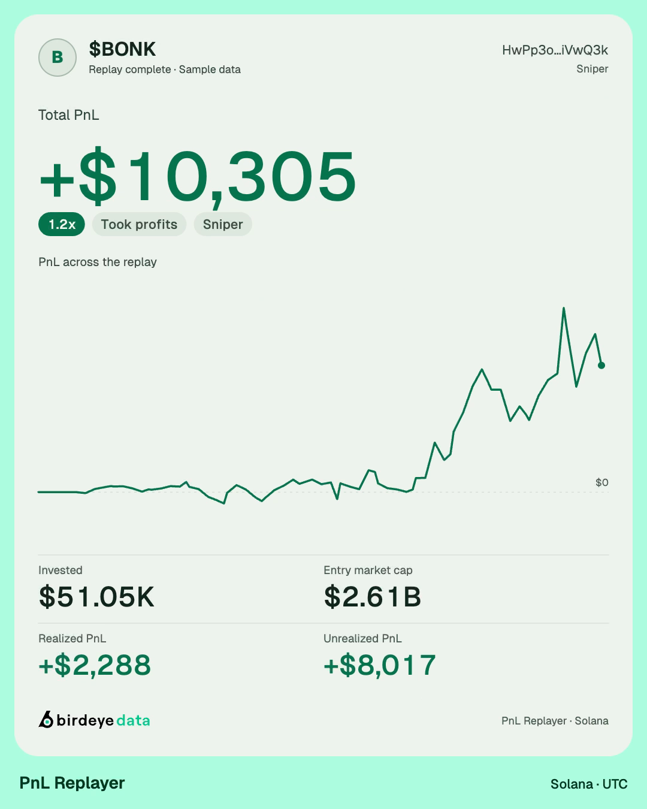

# Birdeye Replayer

**Turn any Solana token's chart, or any wallet's trades, into a shareable
replay video.** Two replays in one app, built entirely on the
[Birdeye Data API](https://data.birdeye.so):

- **Chart replay**: a token's chart over any window, with big trades, smart
  money, KOLs, snipers and the dev marked where they traded.
- **PnL replay**: one wallet's buys and sells on a token, with its PnL
  counting up to a result card.

Candles, trader rankings, wallet PnL, balance changes, wallet-tag flows and
wallet names all come from one provider, and videos render in the browser with
no server.

[](https://github.com/deanle-wq/birdeye-replayer/actions/workflows/ci.yml)
[](./LICENSE)


[](https://vercel.com/new/clone?repository-url=https%3A%2F%2Fgithub.com%2Fdeanle-wq%2Fbirdeye-replayer&project-name=birdeye-replayer&repository-name=birdeye-replayer)

| Chart replay (light) | Chart replay (dark, 16:9) |
|---|---|
|  |  |

| PnL replay | PnL result card |
|---|---|
|  |  |

<sub>Frames from the built-in sample datasets (synthetic charts, tags and wallets).</sub>

## How it flows

1. **Pick a replay.** The start page asks one question: Chart replay or PnL
   replay. A header switch moves between the two at any time; the API key and
   the light/dark choice carry over.
2. **Paste an address.** Chart replay takes a token mint. PnL replay takes a
   token mint (to rank its traders) or a wallet (to list every token it
   traded).
3. **Edit and export.** Both open the same kind of studio: a tool rail, one
   settings panel, a large preview and a timeline. Export MP4 or WebM in 4:5,
   16:9, 9:16 or 1:1 at 1080p, 30 or 60 fps, with sound.

Links share: `/chart?mint=…&from=…&to=…`, `/pnl?mint=…` and `/pnl?wallet=…`
open straight into the result, and Back works.

## Chart replay

1. **Pick the window.** The token's whole history appears as a small chart
   with a window over it. Drag the handles to resize, drag inside to move, or
   use the presets: full history, launch day, last 24h, 7D, 30D and the run
   to the all-time high. Exact UTC times can be typed.
2. **Choose the candles.** The timeframe (1m to 1W) is picked to fit about 14
   candles per second of clip; any timeframe that gives 3 to 8,000 candles
   can be forced.
3. **Add tags.** Each layer switches on or off:

   | Layer | Marker | Source |
   |---|---|---|
   | 🐋 Big trades | One swap at or above your size (Auto picks one) | Trades - Token Filtered By Volume |
   | 🧠 Smart money | Net buy or sell flow of smart traders in a bucket | Token - Wallet Tags Tracker |
   | 🎤 KOLs | Net flow of KOL wallets, named when Birdeye knows them | Wallet Tags Tracker + Details + Wallet Identity |
   | 🎯 Snipers | Net flow of wallets that bought in the first 5 blocks | Wallet Tags Tracker |
   | 🛠️ Dev | Net flow of the token's creator wallet | Wallet Tags Tracker |

   A density control keeps each layer's biggest markers. The exact rules are
   in [TAGS.md](./docs/TAGS.md).
4. **Replay.** Line or candles, a live value badge, tags that stay on the
   chart until their candle scrolls away, and a result card in the outro with
   the period, price or market-cap change, open, close, high and volume.

**Limits worth knowing.** Wallet tags are Solana-only and Birdeye does not
track them for core and very large tokens (SOL, USDC, USDT, BONK); the app
says so and still shows big trades. Big trades top out at 200 swaps per
window; round trips (one wallet buying and selling the same size within two
minutes, as arbitrage bots do) are hidden and counted. Market cap is price ×
today's circulating supply.

## PnL replay

1. **Trader board.** Paste a token mint. Six Birdeye Top Traders rankings are
   unioned (winners, losers, volume, holders) and scored with Birdeye Wallet
   PnL (weighted average cost), with each wallet's Invested and multiple. The
   leading wallet's ledger is audited in the background.
2. **Ledger audit.** Any wallet can be rebuilt from its own balance changes,
   joined to decoded swaps by transaction signature. Each audit gets a high,
   medium or low confidence grade and a delta against Birdeye's number.
3. **Wallet mode.** Paste a wallet, or click one on a board. Every token it
   traded or holds is listed with Birdeye Wallet PnL: logo, Invested, realized
   and unrealized PnL, the multiple and its status. When Birdeye cannot compute
   a wallet's all-time PnL, the list falls back to the last 90 days and says so.
4. **PnL video.** Each row opens the clip editor. It replays the wallet's own
   trading window candle by candle: buys and sells pop up, PnL and its
   multiple run live next to Invested, Entry MC and Sold, and the outro is a
   result card with the PnL curve and up to two tags (🚀 Moonshot, 💎 Diamond
   hands, 💰 Took profits, 📤 Sent out and
   [others](./docs/PNL_METHODOLOGY.md#tags)). The axis switches between price
   and market cap.

The accounting rules are in [PNL_METHODOLOGY.md](./docs/PNL_METHODOLOGY.md),
the endpoint map and live-verified edge cases in
[API_MAPPING.md](./docs/API_MAPPING.md).

**Accuracy boundary.** The audited number is conservative: decoded swaps
contribute confirmed proceeds and costs; incoming transfers create inventory
with unknown cost basis, excluded from unrealized PnL; outgoing transfers
remove inventory and basis but never invent sale proceeds (a wallet that sent
its whole bag away lands on $0 and is tagged 📤 Sent out). The app does not
claim tax-lot accuracy.

## Sound

Both replays share three packs, mixed into the export:

- **Glass & Air** (the default): soft sweeps on key trades and one glass
  chime at the end. No ticks or voice lines.
- **Meme**: a ka-ching on sells and a "bandos" voice call for every $20K of
  PnL.
- **Clean**: synthesised blips, a till sound, milestone fanfares and a result
  sting.

## Quick start

Requires Node.js 20.9 or newer. A Birdeye Data API key is needed for real
data; the built-in samples work without one.

```bash
git clone https://github.com/deanle-wq/birdeye-replayer.git
cd birdeye-replayer
cp .env.example .env.local   # optional: set BIRDEYE_API_KEY
npm install
npm run dev
```

Open http://localhost:3000, pick a replay and paste an address. No key yet?
**Try a sample** on either start screen shows the full flow with clearly
labelled synthetic data.

## Bring your own key

Visitors connect their own Birdeye Data API key from the key icon in the
header, so a public deployment does not have to spend its own compute units.

- The key is kept in the tab's memory only: no localStorage, cookies or URLs.
  Both replays use the same key.
- It travels to this app's API routes in an `x-birdeye-api-key` header, and
  from there to Birdeye. It is never logged.
- A visitor's key takes precedence over the server's `BIRDEYE_API_KEY`. With
  no server key, the app asks visitors for theirs.
- Cached responses are partitioned per key.

## Deploy to Vercel

Use the button above, or deploy from the CLI:

```bash
vercel link
vercel deploy --prod
# optional: let the app pay for visitors who bring no key
vercel env add BIRDEYE_API_KEY production
```

Video rendering runs in the visitor's browser (WebCodecs + Mediabunny), so a
Hobby project is enough. Set `SITE_PASSWORD` to put a public link behind HTTP
Basic auth; the per-IP limit `RATE_LIMIT_PER_MINUTE` is on by default. For a
hard cap, add a Vercel Firewall rate-limit rule.

## Configuration

| Variable | Default | Purpose |
|---|---|---|
| `BIRDEYE_API_KEY` | unset | Server key, used when a visitor brings none |
| `SITE_PASSWORD` | unset | Site-wide Basic-auth password; unset means open |
| `RATE_LIMIT_PER_MINUTE` | `20` | Per-IP live requests per route (×3 for candles); samples are free; `0` disables |
| `AUDIT_WALLETS` | `8` | Wallets audited per `/api/analyze` call (the UI asks for 1) |
| `AUDIT_MAX_EVENTS` | `10000` | Rows per wallet before a ledger is marked truncated |
| `AUDIT_MAX_TRADES` | `5000` | Board audit skips wallets above this many trades |
| `REPLAY_MAX_TRADES` | `7500` | Above this, a wallet's video samples instead of reading its full ledger |
| `CANDIDATES_PER_LENS` | `10` | Top Traders rows per ranking lens (10–30) |
| `BIRDEYE_CONCURRENCY` | `12` | Parallel Birdeye requests per process |
| `CACHE_TTL_SECONDS` | `300` | In-process cache for responses, charts, tag layers and analyses |

[`.env.example`](./.env.example) documents every variable.

## Birdeye Data endpoints and cost

| Endpoint | Used for | CU |
|---|---|---|
| `/defi/v3/ohlcv` | History overview, charts and replay candles, 1m to 1W | 25–100 |
| `/defi/v3/token/meta-data/single`, `/defi/price` | Name, logo, spot price | 3 |
| `/defi/v3/token/market-data` | Circulating supply (market-cap axis, Entry MC), holders | 10 |
| `/token/v1/wallet-tags-tracker` | Chart: smart money, KOL, sniper and dev flow per bucket | 30 |
| `/token/v1/wallet-tags-tracker/details` | Chart: the KOL wallets behind each KOL bucket | 30 |
| `/defi/v3/token/txs-by-volume` | Chart: big trades | 40–200 |
| `/identity/v1/single` | Names for KOLs, big traders and wallets | 30 |
| `/defi/v2/tokens/top_traders` | PnL: board candidates (6 lenses) | 30 |
| `/wallet/v2/pnl/multiple` | PnL: WAC baseline, up to 50 wallets per call | ceil(30 × n^0.8) |
| `/wallet/v2/balance-change` | PnL: ledger quantities | 10 |
| `/defi/v3/token/txs` | PnL: swap side and USD price | 12 |
| `/wallet/v2/pnl/details` | PnL wallet mode: every token a wallet traded, 100 per page | 30 |
| `/wallet/v2/current-net-worth` | PnL wallet mode: current holdings, value and logos | 30 |
| `/defi/v3/token/meta-data/multiple` | PnL wallet mode: names and logos, 20 tokens per call | ceil(3 × n^0.8) |

The **About & data usage** dialog lists every request and its CU live.

## Project structure

```text
birdeye-replayer/
├── src/
│   ├── app/
│   │   ├── page.tsx             replay picker
│   │   ├── chart/page.tsx       Chart replay studio
│   │   ├── pnl/page.tsx         PnL replay workspace
│   │   └── api/                 chart/token · chart/tags · ohlcv · analyze · wallet · token · replay · health
│   ├── components/
│   │   ├── product-brand.tsx    brand, feature switch
│   │   ├── feature-picker.tsx   start page
│   │   ├── studio.tsx           Chart replay: window, tags, preview, export
│   │   ├── dashboard.tsx        PnL replay: board and wallet views
│   │   ├── wallet-video-modal.tsx  PnL clip editor
│   │   └── ui/                  shadcn/ui primitives on Radix
│   ├── lib/                     pure, browser-safe logic: frames, scenes, audio, encoders, tags
│   ├── server/
│   │   ├── birdeye/             typed client, offset pagination, CU meter
│   │   ├── pnl/ledger.ts        weighted-average-cost ledger
│   │   ├── services/            token-chart · chart-tags · analyze-token · wallet-ledger · wallet-replay · wallet-portfolio
│   │   ├── demo.ts, demo-chart.ts  synthetic sample datasets
│   │   └── guard.ts             per-IP rate limit
│   └── proxy.ts                 optional site password
├── public/                      Birdeye Data brand assets, sound packs, video icons
├── scripts/                     live backtests and the wallet audit
├── tests/                       node:test suites
└── docs/                        tag rules, PnL methodology, API mapping, builder guide, media
```

## Scripts

| Command | What it does |
|---|---|
| `npm run dev` | Start the app on http://localhost:3000 |
| `npm run build` / `npm start` | Production build and server |
| `npm test` | Unit and integration tests |
| `npm run typecheck` / `npm run lint` | TypeScript and ESLint |
| `npm run backtest:chart -- <MINT…>` | Replay six windows per token against live Birdeye data and check candles and tags |
| `npm run backtest:wallet -- <WALLET…> [empty]` | Live-check wallet mode: list invariants, paging and replay baselines |
| `npm run audit -- <MINT> <WALLET>` | Print one wallet's ledger, confidence and Birdeye CU usage |
| `npm run icons:video` | Regenerate the Phosphor icons drawn into videos |

[BUILDER_GUIDE.md](./docs/BUILDER_GUIDE.md) covers what Birdeye Data handles
for you, what each step costs and where to extend it.

## License

MIT. See [LICENSE](./LICENSE). Third-party sound samples and icons, and their
notices, are in [THIRD_PARTY_NOTICES.md](./THIRD_PARTY_NOTICES.md).
